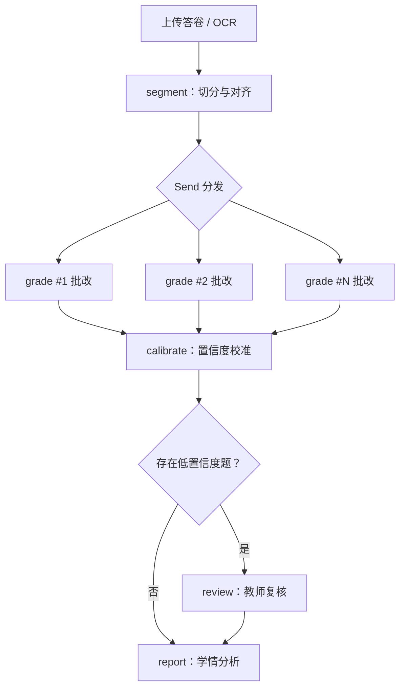

# LangGraph 多 Agent 编排实战：构建智能阅卷与学情分析系统

<div class="post-meta"><span>2026-11-20</span><span>约 10 分钟</span><span>smart_grading · LangGraph 1.2.x</span></div>

> 项目：smart_grading（智能阅卷与学情分析系统）
> 技术栈：Python · FastAPI · LangGraph 1.2.x · PostgreSQL · DeepSeek
> 一句话：不是「让大模型帮我改卷子」，而是把阅卷拆成一张可观测、可回滚、可人工兜底的状态图。

## 一、痛点：传统阅卷系统为什么「改不动」主观题

先说结论：传统阅卷系统不是不会算分，而是**没法处理不确定性**。常见的三条技术路线各有各的死角：

1. **答案字符串匹配 / 关键词命中。** 客观题够用，但开放题一旦学生换个说法、写错一个标点，就判错。语文、政治、实验设计题基本不可用。
2. **规则 + 模板。** 教研组每改一次评分标准，就要重写一批规则；题型越多，规则越像一坨泥，最后没人敢动。
3. **单次大模型调用一把梭。** 看起来 DEMO 能跑，但工程上不可用：一道题输出格式崩了整卷失败，教师不知道模型错在哪，也没法只重跑某一题。

所以这个系统真正要解决的是四件事，而不是「接入一个更聪明的模型」：

- **逐题批改**：每道题独立评分、独立重试，一道题坏掉不影响整卷；
- **教师只复核没把握的题**：教师的时间很贵，应该花在模型不确定的地方；
- **评分可解释**：给出命中的评分点、引用的学生原文，而不是一个光秃秃的分数；
- **结果能沉淀**：按知识点聚合成学情分析，下一次备课能用得上。

## 二、架构设计：把一次批改拆成一张图

LangGraph 的价值不是「多 Agent 听起来高级」，而是它允许你把业务流程**显式建模**：

- 节点 = 一次可重试的计算；
- 边 = 状态如何流转；
- checkpointer = 进程挂了能续跑；
- `interrupt` = 把人工介入变成流程里的正常环节，而不是外挂的审批接口。



几个关键设计决定：

- **切分与批改分离。** `segment` 只做结构化：题干、学生作答、参考答案、评分点一一对齐，输出 `Question` 列表。它不负责判断对错，因此可以被单独替换成 OCR 版本或人工录入版本。
- **按题 fan-out。** 用 LangGraph 的 `Send` API 把每道题发给独立的批改节点，天然并发；单题失败只影响自己。
- **结果必须结构化。** 每个批改 Agent 的输出都过一遍 Pydantic 校验，并携带 `confidence` 与评分点命中证据。
- **置信度决定路由。** 低于阈值进入教师复核队列，教师确认后再继续出报告；这一步用 `interrupt` 实现，任务状态落库，刷新页面也能接着处理。
- **State 只存事实。** 题目、评分、证据、置信度进 State，模型的中间思考过程不进。这样结果可回放、可审计、可复现。

## 三、核心实现

### 3.1 状态与图定义

State 用一个 `TypedDict` 描述，批改结果和复核队列用 reducer 累加，这是多个并发节点往同一个字段写数据的标准做法。

```python
# app/state.py
import operator
from typing import Annotated, TypedDict


class GradingState(TypedDict):
    exam_id: str
    questions: list[dict]                                  # segment 输出的题目
    results: Annotated[list[dict], operator.add]           # 各 Agent 的批改结果
    review_queue: Annotated[list[int], operator.add]       # 需要教师复核的题号
```

```python
# app/graph.py
from langgraph.graph import StateGraph, START, END
from langgraph.types import Send
from langgraph.checkpoint.memory import InMemorySaver


def fan_out(state: GradingState) -> list[Send]:
    """每道题一个独立的 grade 节点，互不阻塞。"""
    return [
        Send("grade", {"exam_id": state["exam_id"], "question": q})
        for q in state["questions"]
    ]


def build_graph(llm):
    graph = StateGraph(GradingState)

    graph.add_node("segment", segment_questions)

    async def grade(state: dict) -> dict:
        return await grade_one_question(state, llm=llm)

    graph.add_node("grade", grade)
    graph.add_node("calibrate", calibrate_confidence)
    graph.add_node("review", wait_for_teacher)   # 内部调用 interrupt()
    graph.add_node("report", build_report)

    graph.add_edge(START, "segment")
    graph.add_conditional_edges("segment", fan_out, ["grade"])
    graph.add_edge("grade", "calibrate")
    graph.add_conditional_edges(
        "calibrate",
        lambda s: "review" if s["review_queue"] else "report",
        {"review": "review", "report": "report"},
    )
    graph.add_edge("review", "report")
    graph.add_edge("report", END)

    # 生产环境换成 PostgresSaver，中断后可以跨进程恢复
    return graph.compile(checkpointer=InMemorySaver())
```

### 3.2 批改节点：把「格式不稳定」当成正常输入

真实的大模型不会每次都给你干净的 JSON，所以节点内部必须自带修复循环，并且在彻底失败时把题目降级为「待复核」，而不是抛异常炸掉整卷。

```python
# app/nodes/grading.py
from pydantic import ValidationError
from app.schemas import GradingResult


async def grade_one_question(state: dict, *, llm) -> dict:
    question = state["question"]
    messages = build_prompt(question)

    for _ in range(3):
        raw = ""
        try:
            raw = await llm.chat_json(messages, temperature=0)
            result = GradingResult.model_validate(raw)
            return {
                "results": [
                    {**result.model_dump(), "question_no": question["no"]}
                ],
                "review_queue": [question["no"]] if result.confidence < 0.75 else [],
            }
        except (ValidationError, ValueError) as exc:
            # 把校验错误回传给模型：只修格式，不许改结论
            messages += [
                {"role": "assistant", "content": raw},
                {"role": "user", "content": f"输出不符合 schema：{exc}。请只修正 JSON 后重试。"},
            ]

    # 三次仍失败：降级为待复核，绝不阻塞整卷
    return {"review_queue": [question["no"]]}
```

### 3.3 用 Mock 客户端写确定性测试

图文无关地说，LLM 是最不稳定的外部依赖。测试里必须把它换成完全可控的假客户端——注意是**接口级 Mock**，不是把整个图打桩，否则你测不到路由和状态合并。

```python
# tests/fakes.py
import copy


class MockDeepSeek:
    """按调用顺序返回预设响应，可注入异常，用来复现「格式漂移」的真实故障。"""

    def __init__(self, payloads: list):
        self.payloads = copy.deepcopy(payloads)
        self.calls = 0

    async def chat_json(self, messages, *, temperature=0.0):
        self.calls += 1
        item = self.payloads.pop(0)
        if isinstance(item, Exception):
            raise item
        return item
```

```python
# tests/test_grading_graph.py
import pytest
from app.graph import build_graph
from tests.fakes import MockDeepSeek

pytestmark = pytest.mark.asyncio  # 需要 pytest-asyncio

QUESTION = {"no": 1, "stem": "计算 2 + 2", "answer": "4", "score": 5.0}
VALID = {"score": 5.0, "confidence": 0.92,
         "rubric_hits": ["结果正确"], "evidence": "学生作答：4"}


async def run_graph(payloads):
    llm = MockDeepSeek(payloads)
    graph = build_graph(llm)
    state = {"exam_id": "e2e-001", "questions": [QUESTION],
             "results": [], "review_queue": []}
    final = await graph.ainvoke(
        state, config={"configurable": {"thread_id": "t-1"}}
    )
    return final, llm


async def test_normal_grading_calls_model_once():
    final, llm = await run_graph([VALID])
    assert final["results"][0]["score"] == 5.0
    assert final["review_queue"] == []
    assert llm.calls == 1


async def test_dirty_output_is_repaired():
    dirty = "好的，以下是批改结果：{score: 5, confidence: 0.9}"   # 不是合法 JSON
    final, llm = await run_graph([dirty, VALID])
    assert llm.calls == 2
    assert final["results"][0]["score"] == 5.0


async def test_low_confidence_goes_to_review_queue():
    final, _ = await run_graph([{**VALID, "confidence": 0.42}])
    assert final["review_queue"] == [1]
```

这三个用例分别锁住了三件事：**正常路径的调用次数、格式故障的自动修复、不确定结果的正确路由**。它们跑起来不需要网络、不需要 API Key，可以在 CI 里跟普通单测一样快。

## 四、踩坑与优化

### 4.1 大模型返回格式不稳定

这是上线前最耗时间的问题，我们最后收敛成五层防御：

1. **约束输出。** 优先用 JSON mode / structured output，schema 由 Pydantic 生成，别在 prompt 里手写 JSON 示例。
2. **校验失败就回传错误重试。** 把 `ValidationError` 原文塞回对话，温度设为 0，最多重试两次——大多数格式问题一次就能修好。
3. **正则兜底。** 模型偶尔会在 JSON 外包裹解释文字，用「取第一个 `{` 到最后一个 `}`」的方式兜底提取。
4. **单题隔离。** 修复失败就标记为待复核，绝不让一道题拖垮整卷。
5. **幂等缓存。** 用 `question_hash + prompt_version` 作为缓存键，重跑整卷时不会为同一道题重复付费。

还有一个容易忽略的点：**字段漂移比语法错误更难修**。比如模型把 `score` 写成字符串 `"5"`，Pydantic 默认能转；但如果它把 `rubric_hits` 写成一句话，就得在 schema 里明确 `list[str]` 并给出字段说明，让模型知道该填什么。

### 4.2 置信度阈值不是拍脑袋定的

0.75 这个数字来自一次小规模校准：拿 200 份历史答卷做人工标注，画出「置信度—实际准确率」曲线，选择准确率开始明显下滑的拐点作为复核线。上线后每月看两个指标：

- **复核率**：太高说明模型没把握，教师负担反而更大；
- **复核修改率**：教师改动的比例，直接反映模型判断质量。

教师改过的题会被回流成 bad case 集。每次改 prompt 或换模型，先在这个集合上跑回归，看准确率、复核率、平均耗时有没有退化，再决定是否发布。**prompt 和 graph 的版本号，跟评测报告一起进发布记录。**

### 4.3 成本与观测

- **并发**：FastAPI + `asyncio.Semaphore` 控制单个答卷的并发批改数，避免把上游限流打满；
- **成本**：评分点抽取每题只做一次并缓存，批改 Agent 只带当前题目的评分点，不带整卷；
- **观测**：每个节点记录 token 数、耗时、失败原因，按试卷维度聚合，找出最慢和最贵的题型；
- **存储**：PostgreSQL 存任务与结果，评分点命中证据用 JSONB，既方便前端展示也方便后续统计；
- **恢复**：生产用 `PostgresSaver` 做 checkpoint，服务重启后未完成的任务可以接着跑。

## 五、总结

把「AI 批改」做成产品，核心不是模型多强，而是把模型的不确定性收进工程边界里：**流程显式、输出结构化、测试确定性、失败可降级、人工可介入、数据可回流。**

LangGraph 提供的正是这套骨架。它不会让你的模型变得更准，但会让你的系统在模型不准的时候，依然是个能交付的系统。

下一篇会聊另一个方向——把静态绘本变成动态视频，那里面的不确定性从「文本格式」换成了「异步任务和视频生成质量」。
