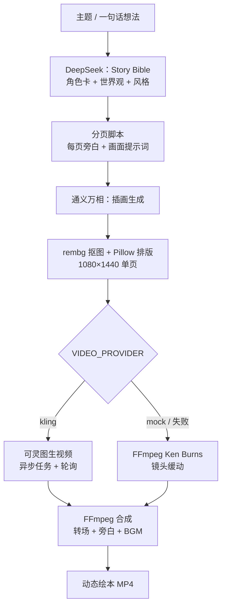

# 从静态到动态：基于可灵 API 的 AI 绘本工作台实战

<div class="post-meta"><span>2026-11-24</span><span>约 14 分钟</span><span>storycast · 多模态 AIGC</span></div>

> 项目：storycast（AI 智能绘本工作台）
> 技术栈：FastAPI · React 19 · DeepSeek · 通义万相 · 可灵（Kling）图生视频 · FFmpeg
> 一句话：让不会画画的幼师，用一段文字在十分钟内得到一本「会动」的绘本。

## 一、业务背景：幼师做一本绘本，卡在哪

做幼教内容的朋友给我算过一笔账：一本 12 页的原创绘本，如果外包插画，按页计价，改图还要另算周期；如果自己用 PPT 拼，风格不统一，孩子看两页就走神。

具体拆开是四个卡点：

- **故事能写，但写不成「绘本节奏」。** 幼师会讲故事，却不一定能把故事拆成 12 页、每页一句旁白加一个画面。
- **配图不会画。** 外包贵、周期长，改一次颜色就要重新沟通。
- **排版靠手工。** Word / PPT 拼图，字号、留白、风格全靠感觉，成品质感不稳定。
- **静态成品留不住注意力。** 3–6 岁的孩子对「会动的东西」明显更感兴趣，但动画外包按秒计价，一本绘本动起来要几千块。

所以 storycast 的产品目标很明确：**输入一个主题，输出一本完整的动态绘本**——分页故事、统一画风的插画、朗读音频、以及每页 5 秒的动态视频。两个硬约束贯穿了整个设计：

1. 使用者没有美术基础，所有中间产物必须**可看、可改、可重生成**；
2. 演示环境可能没有外网 Key、可能遇到接口失败，**但演示绝不能挂**。

## 二、核心链路



### 2.1 长文本记忆：先写「设定集」，再写故事

直接让模型一次性生成 12 页故事，最常见的问题是后几页开始跑偏：角色换了名字、性格突变、画风从水彩变成厚涂。

我们的做法是先生成一份结构化的 **Story Bible**：

- 角色卡：姓名、年龄、外观（发型/服装/主色）、性格、口头禅；
- 世界观：时间、地点、规则（比如「月亮会说话」）；
- 风格约定：画风、色调、镜头语言。

分页生成时，全局设定常驻 system prompt，前文用「摘要树」压缩——每三页生成一段摘要，越早的内容摘要越短。这样 20 页之后，模型仍然记得主角戴的是红围巾，而不是把上下文硬塞到超限。

### 2.2 角色一致性：结构化 + 参考图

文字层面的角色卡只解决「描述一致」，解决不了「长得一致」。我们在图像侧做了两件事：

1. 每页的提示词都带同一段角色描述前缀（外观、配色、服装），并固定风格词；
2. 用同一张角色参考图做图生图的参考输入，让通义万相在生成新场景时保持面部与服装特征。

即便如此，仍会有 10%–20% 的图需要重生成。产品上我们不做「一次成功」的假设，而是把「重生成这一页」做成显眼的一级操作。

### 2.3 一键抠图与排版

插画生成后，用 rembg 在本地做前景分割（U2-Net 模型），得到带透明通道的角色图层，再和背景、旁白文字条、装饰元素分层合成。好处有两个：

- 排版时可以单独调整角色的位置和大小，做出「角色站在文字旁边」的构图；
- 动态化阶段，如果走降级方案，角色层和背景层可以做出轻微的视差感。

排版用 Pillow 完成：固定 1080×1440 竖版画布，统一字体、行高、圆角与投影。模板化之后，同一套主题的绘本视觉风格天然统一。

### 2.4 RAG 角色扮演

绘本生成完成后，孩子可以和书里的角色对话。这部分没有用「把整本书塞进上下文」的偷懒方案，而是：

- 把角色卡、世界观、每页剧情切片写入向量库；
- 对话时按当前问题召回相关片段，拼成角色视角的上下文；
- prompt 里明确约束：保持角色口吻、不跳出世界观、不知道的事情就说不知道。

这样既控制了 token 成本，也避免了长对话里角色「出戏」。

## 三、动态化方案对比（重点）

这是整个项目里讨论最久的部分。我们要的不是「角色精确表演」，而是「画面呼吸起来」。三个候选方案：

| 维度 | 局部骨骼动画（Live2D / Spine） | 前端 CSS 缓动（Ken Burns / 视差） | 可灵图生视频 |
| --- | --- | --- | --- |
| 实现成本 | 高：需拆层、绑骨、做动作库 | 低：半天可完成 | 中：1 天接入 API |
| 美术依赖 | 强：每个角色都要美术绑定 | 无 | 无 |
| 效果上限 | 动作可控、表情精确 | 只有镜头推拉，人物不动 | 画面自然微动，保留原画风 |
| 单页成本 | 前期一次性投入高 | 0 | 按秒计费 |
| 失败可控性 | 高（本地渲染） | 高 | 中：异步、偶发畸变 |
| 适配场景 | 固定 IP 虚拟形象 | 兜底、封面、过渡 | 画风多变的原创绘本 |

逐个说：

**局部骨骼动画**效果最好，但它假设「角色是分层的、可绑定的」。绘本插画是水彩、厚涂、拼贴风格，角色和背景常常长在一起，拆层本身就是一次美术再创作。一个角色 1–2 天，一本绘本换一种画风就得重来。它适合固定 IP，不适合「一本一个画风」的产品。

**前端 CSS 缓动**是性价比之王：`transform: scale()` 加 `translate()`，再配一点视差，半天就能做出「镜头缓慢推近」的效果。但它的本质是整张图的变换，角色不会产生任何动作，10 页看下来仍然是「会动的 PPT」。我们把它定位为兜底方案和封面动效，而不是卖点。

**可灵图生视频**是唯一同时满足「零美术依赖 + 保留原画风 + 真的在动」的方案：上传一张单页插画，给一句运动描述（比如「角色轻轻眨眼，围巾随风飘动，镜头缓慢推近」），异步生成 5 秒视频。代价是动作不可精确编排、偶发畸变需要筛选，以及异步任务带来的等待。

最终决策：**可灵做主链路，CSS / FFmpeg 缓动做降级。** 判断依据不是「哪个效果最炫」，而是目标用户没有美术能力、每本绘本画风不同、动态需求停留在「画面有生命感」这一层。对这三条约束，图生视频是成本最低的解。

## 四、接口实现：可灵 API 的异步调用

可灵 API 用 AK/SK 签发 JWT 鉴权，创建任务后拿 `task_id` 轮询结果。下面是最小可用实现（省略了错误码细分和日志）。

```python
# app/providers/kling.py
import asyncio
import time

import httpx
import jwt

KLING_BASE = "https://api-beijing.klingai.com"


def make_token(ak: str, sk: str) -> str:
    """可灵要求用 AccessKey/SecretKey 签 JWT，有效期 30 分钟。"""
    now = int(time.time())
    return jwt.encode(
        {"iss": ak, "exp": now + 1800, "nbf": now - 5},
        sk,
        algorithm="HS256",
    )
```

```python
async def create_image2video(client: httpx.AsyncClient, image_url: str,
                             prompt: str, token: str) -> str:
    resp = await client.post(
        f"{KLING_BASE}/v1/videos/image2video",
        headers={"Authorization": f"Bearer {token}"},
        timeout=30,
        json={
            "model_name": "kling-v1-6",
            "mode": "std",                 # 标准模式，适合批量出片
            "duration": "5",               # 5 秒或 10 秒
            "image": image_url,            # 单页插画的公网 URL
            "prompt": prompt,              # 运动描述，不是重新画图
            "negative_prompt": "模糊, 畸变, 多手多脚, 文字水印",
            "cfg_scale": 0.5,
        },
    )
    data = resp.json()
    if data.get("code") != 0:
        raise KlingError(data.get("message", "create failed"))
    return data["data"]["task_id"]


async def wait_for_video(client: httpx.AsyncClient, task_id: str,
                         token: str, *, timeout: int = 600) -> str:
    deadline = time.monotonic() + timeout
    while time.monotonic() < deadline:
        resp = await client.get(
            f"{KLING_BASE}/v1/videos/image2video/{task_id}",
            headers={"Authorization": f"Bearer {token}"},
            timeout=30,
        )
        data = resp.json()["data"]
        if data["task_status"] == "succeed":
            return data["task_result"]["videos"][0]["url"]
        if data["task_status"] == "failed":
            raise KlingError(data.get("task_status_msg", "task failed"))
        await asyncio.sleep(5)             # 轮询间隔别太激进
    raise KlingTimeout(task_id)
```

编排层用 `Semaphore` 控制并发，每页独立 try/except——**单页失败只降级这一页，不影响整本书**：

```python
async def render_pages(book_id: int, pages: list[Page]) -> list[str]:
    token = make_token(settings.kling_ak, settings.kling_sk)
    sem = asyncio.Semaphore(3)

    async def one(page: Page) -> str:
        async with sem:
            try:
                task_id = await create_image2video(
                    client, page.image_url, page.motion_prompt, token
                )
                return await wait_for_video(client, task_id, token)
            except (KlingError, KlingTimeout) as exc:
                logger.warning("page %s 动态化失败，降级：%s", page.no, exc)
                return await ken_burns_fallback(page)   # 本地 FFmpeg 出片

    return await asyncio.gather(*(one(p) for p in pages))
```

工程上还有几个必要的细节：

- **任务落库**：创建任务就把 `task_id`、页码、状态写进 PostgreSQL，页面刷新或服务重启后仍能继续轮询；
- **进度推送**：前端用 SSE 订阅「第 3/12 页生成中」，而不是让用户盯着转圈；
- **幂等缓存**：以 `page_hash + provider + prompt_version` 为键，同一页重复生成直接复用已有视频；
- **转存**：上游返回的视频 URL 会过期，生成成功后立刻下载到对象存储，前端只访问自己的 CDN。

## 五、降级策略：演示永远不能挂

Demo 翻车通常不是因为主流程写错，而是因为演示当天网络、配额、审核任意一个环节出问题。所以我们从第一天就把降级当成功能来做。

**第一层：无 Key 也能跑。** `VIDEO_PROVIDER=mock` 时整条链路照常执行，动态化换成本地 FFmpeg 的 Ken Burns 缓动。输出依然是 MP4，产品流程完整可演示。

**第二层：单页失败只损失一页。** 可灵调用失败或超时（600s），该页自动换成静态图 + 缓慢推近，其余页正常合成。

**第三层：熔断与预算。** 连续 5 次失败后 60 秒内直接走降级，避免反复撞墙；每本绘本设置动态页预算（比如最多 8 页走可灵），防止演示时把额度烧光。

FFmpeg 的两种出片方式如下：

```bash
# 降级：单页静态图 → 5 秒 Ken Burns 推镜头
ffmpeg -y -loop 1 -i page.png \
  -vf "scale=1600:-1,zoompan=z='min(zoom+0.0006,1.10)':x='iw/2-(iw/zoom/2)':y='ih/2-(ih/zoom/2)':d=125:s=1280x720:fps=25,format=yuv420p" \
  -t 5 -c:v libx264 -preset veryfast -crf 22 page.mp4

# 合成：按顺序拼接 + 旁白 + BGM（BGM 音量压到 0.18，避免盖住朗读）
ffmpeg -y -f concat -safe 0 -i clips.txt \
  -i narration.mp3 -i bgm.mp3 \
  -filter_complex "[0:v]scale=1280:720:force_original_aspect_ratio=decrease,pad=1280:720:(ow-iw)/2:(oh-ih)/2,fps=25,format=yuv420p[v];[1:a]volume=1.0[a1];[2:a]volume=0.18[a2];[a1][a2]amix=inputs=2:duration=first[a]" \
  -map "[v]" -map "[a]" -c:v libx264 -preset medium -crf 20 -c:a aac -shortest book.mp4
```

前端也有降级：视频没加载出来之前先显示静态图加 CSS 动效占位，`loadeddata` 后再淡入视频，避免出现黑色占位块。

## 六、总结

动态绘本这个需求，看起来是「接一个视频生成 API」，实际做下来是三个问题叠在一起：

1. **输入侧的一致性**：Story Bible、角色卡、参考图，解决「越生成越不像」；
2. **中间态的异步与成本**：任务表、轮询、SSE、幂等缓存、并发控制，解决「用户等不了、预算烧不起」；
3. **输出侧的确定性**：降级、熔断、预算上限，解决「演示不能挂」。

可灵解决的是「画面动起来」，工程解决的是「每次都能交付」。这也是我做大模型应用一直坚持的判断：**模型负责效果上限，工程负责效果下限。** 上限决定了别人愿不愿意用，下限决定了它能不能上线。
